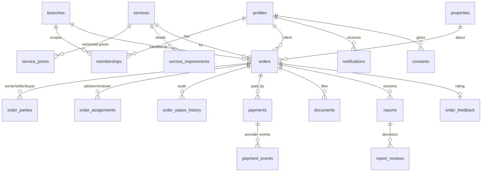

# M ADVISORY — Architecture

## System

```
Browser (Mongolian-first, mobile-first)
   │  Server Components + Server Actions (no client-side DB access)
   ▼
Next.js App Router on Vercel ──► Supabase Auth (prod) / local dev auth
   │  every request: BEGIN; SET LOCAL ROLE authenticated; request.jwt.claims = {sub}
   ▼
Supabase PostgreSQL
   ├─ RLS on every public table (reads)
   ├─ app.* SECURITY DEFINER functions (all workflow writes, validated per actor)
   ├─ audit_logs (append-only) · integration_events (outbox for TsogtsAI)
   └─ private Storage buckets: order-documents, reports
Payments: PaymentProvider interface → QPay v2 adapter (prod) / mock (dev+test only)
```

Security is enforced in the database, then re-checked on the server; the UI only hides
what the user cannot do. Server secrets are read only in `src/lib/env.ts` (server-only).

## Data model



Rules: UUID keys + human order numbers (`MA-2026-000123`); money is `bigint` MNT;
price, terms and consent are snapshotted on submission; one active advisor and one
active reviewer per order; reviewer ≠ advisor; at most one pending and one paid
payment per order; a report can be published only when approved by someone other than
its author.

## State machines (separate columns, separate tables)

| Order | Payment | Report |
|---|---|---|
| draft → awaiting_payment → paid → assigned → in_progress ⇄ needs_information → under_review ⇄ revision_requested → completed; cancelled | pending → paid / failed / expired / cancelled; paid → refund_pending → refunded | draft → submitted → revision_requested / approved → published |

`app.order_transition_rules` lists every allowed (from, to, actor). `paid` and
`completed` can only be reached by the system (verified payment, published report).

## Routes

Public: `/`, `/services`, `/services/[slug]`, `/order/[service]`, `/login`, `/register`, `/legal/*`
Client: `/dashboard`, `/dashboard/orders`, `/dashboard/orders/[id]`, `/dashboard/documents`, `/dashboard/reports`, `/account`
Staff: `/admin`, `/admin/orders`, `/admin/orders/[id]`, `/admin/payments`, `/admin/clients`, `/admin/advisors`, `/admin/services`, `/admin/pricing`
API: `/api/payments/callback` (HMAC-authenticated, then server-to-server check), `/api/health`, `/auth/callback`

## Phase plan

| Phase | Status |
|---|---|
| 1 Foundation: design system, auth, roles, migrations, catalogue, public pages | Done |
| 2 Ordering & payment: wizard, drafts, price snapshot, QPay adapter, idempotent verification | Done except document upload + QPay sandbox run |
| 3 Operations: admin/advisor/reviewer dashboards, assignment, status history | Assignment + transitions done; report editor, review, PDF, notifications UI to do |
| 4 Security & launch: RLS tests, reconciliation, backups, pilot orders | RLS/permission/payment tests done; rest to do |
